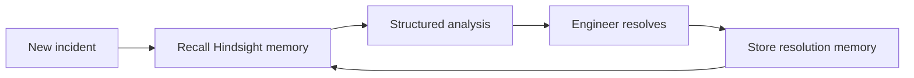

# IncidentMind

AI Incident Response Agent That Learns From Past Incidents.

IncidentMind turns every resolved incident into searchable operational knowledge. When a similar problem appears, the agent retrieves the prior resolution before it recommends a safe, engineer-verified response.

## Hindsight learning loop

The default `HINDSIGHT_MODE=mock` is a local SQLite adapter, visibly labelled in the UI. It is not presented as a cloud Hindsight connection. `backend/app/services/hindsight_service.py` is the single integration boundary. Cloud mode uses Hindsight's official retain and recall endpoints and fails clearly if its URL, API key, or bank ID are absent.

## Stack

React + TypeScript + Vite frontend; FastAPI + SQLAlchemy + SQLite backend. The agent is provider-agnostic: `LLM_MODE=mock` is deterministic, while `LLM_MODE=groq` is configured with `GROQ_API_KEY` and `LLM_MODEL`.

## Run locally

1. `cd backend; py -3 -m pip install -r requirements.txt`
2. `py -3 -m app.db.seed`
3. `py -3 -m uvicorn app.main:app --reload`
4. In another terminal: `cd frontend; npm install; npm run dev`
5. Open `http://localhost:5173`.

Run backend checks with `cd backend; py -3 -m pytest -q` and build the UI with `cd frontend; npm run build`.

## Phase 1 features

Dashboard analytics, incident creation and register, agent analysis, memory-aware recommendations, resolution capture, stored outcome memories, seeded realistic history, REST API, and tests. See [architecture](docs/architecture.md), [API](docs/api.md), and [demo flow](docs/demo-flow.md).
